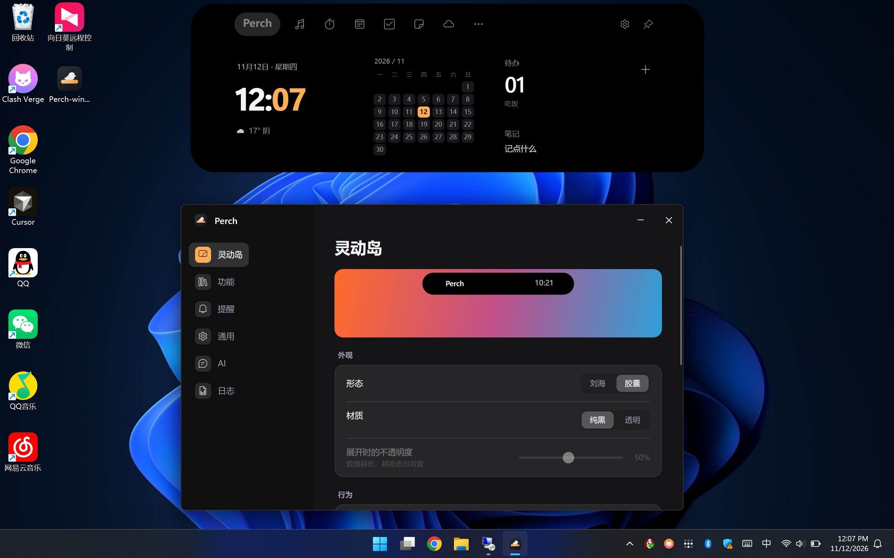

# 栖点 Perch

一个放在屏幕顶部的桌面小工具。平时收成一颗胶囊，鼠标移上去就能展开，听歌、记事、看日程、聊 AI 都在这里。

**Windows 版功能齐全，已经稳定可用。Linux 支持还在完善中。**

[下载 v1.0.0](https://github.com/0use-TE/Perch/releases/tag/v1.0.0) · [介绍网站](http://0use.net/Perch/) · [使用教程](http://0use.net/Perch/tutorial.html)



## 下载使用

Windows 版提供 x64 和 ARM64 两个版本，都是 AOT 单文件，下载后双击运行，不用安装 .NET。

- [Windows x64](https://github.com/0use-TE/Perch/releases/download/v1.0.0/Perch-win-x64.exe)：Intel / AMD 电脑。
- [Windows ARM64](https://github.com/0use-TE/Perch/releases/download/v1.0.0/Perch-win-arm64.exe)：骁龙等 ARM 电脑。

启动后，小岛会出现在主屏幕顶部。点击齿轮打开设置，可以调整外观、开启需要的功能、排列导航栏。退出程序可以右键托盘图标。

## 能做什么

- **日常工具**：音乐控制、番茄钟、待办、笔记、日历、天气和闹钟。
- **随手存取**：剪贴板历史与置顶、文件中转、应用启动和全局搜索。
- **AI 对话**：使用自己的模型服务，支持深度思考、联网搜索，也能帮你操作电脑。
- **系统状态**：查看 CPU、内存、磁盘、网速和监听端口。
- **小恐龙**：内置跑酷小游戏，休息时来一局，最高分会保留。

外观可以选刘海或胶囊、纯黑或透明；支持中英文、快捷键和导航排序。设置、笔记和待办保存在本机，AI 和天气等在线功能按需联网。

AI 需要在「设置 → AI」里添加服务和模型，可用 DeepSeek、OpenAI 等兼容服务，也可连接本地 Ollama / LM Studio。操作电脑的权限和执行前确认方式也在这里设置。

| 默认快捷键 | 操作 |
| --- | --- |
| `Ctrl + Alt + I` | 展开 / 收起小岛 |
| `Ctrl + Alt + N` | 新建笔记 |
| `Ctrl + Alt + F` | 全局搜索 |

## 平台支持

**Windows 是目前的主要使用平台**，功能已经齐全，适合日常使用。当前发布的安装包只有 Windows x64 和 ARM64。

**Linux 还在适配中**，目前已有 Arch Linux x86_64 / X11 的初步支持，功能和桌面兼容性仍在完善，暂未提供正式发布包。想尝试或参与适配，可以看 [Linux 文档](docs/linux.md)。

## 从源码运行

项目使用 C#、Avalonia 12 和 .NET 10。在 Windows 上安装 .NET 10 SDK 后运行：

```powershell
git clone https://github.com/0use-TE/Perch.git
cd Perch
dotnet run --project src/Perch/Perch.csproj
```

发布 Windows AOT 单文件还需要 Visual Studio 的「使用 C++ 的桌面开发」工具；构建 ARM64 时需安装对应的 MSVC ARM64 工具。

```powershell
$env:PATH += ";${env:ProgramFiles(x86)}\Microsoft Visual Studio\Installer"
dotnet publish src/Perch/Perch.csproj -c Release -r win-x64 -p:PublishAot=true -o artifacts/win-x64
```

ARM64 将 `win-x64` 换成 `win-arm64`。发布目录中的 `Perch.exe` 可以单独运行。

## 反馈与许可

遇到问题可以提 [Issue](https://github.com/0use-TE/Perch/issues)，附上系统版本、复现步骤，以及「设置 → 日志」中的相关记录。

[MIT License](LICENSE) · [第三方声明](THIRD-PARTY-NOTICES.md)
